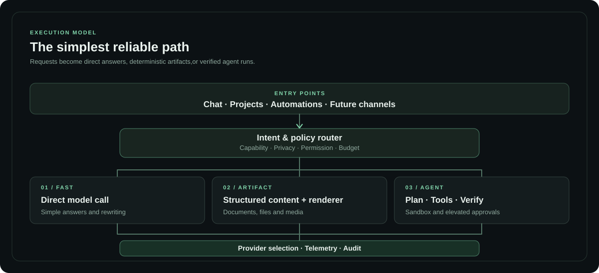

<div align="center">
  <a href="VISION.md">
    
  </a>

  <h1>Vector</h1>

  <p><strong>
    Reliable intelligence. Deliberate execution.
  </strong></p>

  <p>
    A private AI workbench built for meaningful work,
    measurable quality and controlled autonomy.
  </p>

  <p>
    <a href="VISION.md"><strong>Vision</strong></a> ·
    <a href="docs/ARCHITECTURE.md"><strong>Architecture</strong></a> ·
    <a href="docs/ROADMAP.md"><strong>Roadmap</strong></a> ·
    <a href="docs/DEVELOPMENT.md"><strong>Development</strong></a> ·
    <a href="docs/THIRD_PARTY.md"><strong>Credits</strong></a>
  </p>

  <p>
    
    
    
    
  </p>
</div>

---

## Overview

**Vector is a personal AI workspace in active development.**

It brings conversations, project work, provider management,
file workflows and background execution into one intentionally
restrained interface.

The long-term goal is an AI operating system that can plan,
act, verify and improve — while keeping its owner in control.

Vector favors **the simplest execution path that can
reliably finish the job**.

A rewrite should not launch an agent team. A generated document
should not require a browser agent. Complex research, coding
and infrastructure work can use specialized tools with
approval boundaries.

### Explore

| | | |
| :-- | :-- | :-- |
| [**The product**](#the-product) | [**Architecture**](#architecture) | [**Development**](#development) |
| [**Capabilities**](#capabilities) | [**Safety and privacy**](#safety-and-privacy) | [**Credits**](#acknowledgements) |

## The product

Vector uses a dark, understated design language:
precise hierarchy, real information, quiet mint accents
and motion with a purpose.

It is built for everyday use rather than
presentation-only dashboards.

<!-- VECTOR_SCREENSHOTS_START -->
> **Screenshots are being prepared.** Genuine, privacy-reviewed captures of the login, dashboard, chat, models and server views will be added here. No fabricated interface imagery is used.
<!-- VECTOR_SCREENSHOTS_END -->

[Product screenshot guidelines →](docs/screenshots/README.md)

## Capabilities

The following areas are **present in today's application source**.
Completeness, reliability and user access vary by feature;
future capabilities are not represented as shipped.

<table>
  <tr>
    <td width="50%" valign="top">
      
      <h3>Conversations &amp; projects</h3>
      Chat threads, project workspaces and background tasks
      in a unified UI.
    </td>
    <td width="50%" valign="top">
      
      <h3>Models &amp; usage</h3>
      Provider connections, model configuration
      and usage tracking.
    </td>
  </tr>
  <tr>
    <td valign="top">
      
      <h3>Files &amp; artifacts</h3>
      File upload, generation and rendering foundations
      for document workflows.
    </td>
    <td valign="top">
      
      <h3>Permissions &amp; approvals</h3>
      Privacy checks, configurable permissions
      and owner-controlled actions.
    </td>
  </tr>
</table>

### Where Vector is heading

| Focus | Intended outcome |
| :-- | :-- |
| **Intelligent routing** | Choose models with measured quality, latency, cost, provider health and privacy constraints. |
| **Artifact Studio** | Create and edit batches of documents and images, preview changes and preserve existing file structure. |
| **Agent orchestration** | Delegate only when useful; use isolated tools, verified results and safe retries. |
| **Skills & improvement** | Discover, scan, test and evaluate skills before activation. |
| **Connected channels** | Email, WhatsApp, Discord, Minecraft and voice under the same approval system. |
| **Developer workbench** | Test code in isolated environments and publish controlled previews. |

[Full roadmap →](docs/ROADMAP.md)

## Architecture

A single request should follow one of three execution paths.
The diagram below is a **static SVG**, not an interactive
Mermaid canvas.

<div align="center">
  
</div>

| Path | Best for | Operating principle |
| :-- | :-- | :-- |
| **Fast** | Questions, rewriting and routine analysis | Direct provider call; avoid unnecessary orchestration. |
| **Artifact** | Documents, spreadsheets, images and presentations | Structured content and deterministic renderers where possible. |
| **Agent** | Research, coding, tool use and infrastructure | Plan, execute, verify and require approval for elevated actions. |

**Target components under evaluation:**

Mastra vs Pydantic AI, LiteLLM vs TensorZero, AG-UI-style
events, a curated Agent Skills registry, Docling, Langfuse,
Promptfoo and selective MCP tools.

These are **not all installed today**.

[Read the detailed architecture →](docs/ARCHITECTURE.md)

## Safety and privacy

- **Owner approval:** production changes, outbound messages
  and privileged actions require authorization.
- **Sensitive data:** reduce external exposure, with local
  classification and redaction where appropriate.
- **Reliable retries:** never replay an irreversible operation
  without idempotency protections.
- **No unverified success:** test the output and report
  the actual result.
- **Private by default:** the production deployment configuration,
  user data and credentials are not part of this repository.

[Security model →](docs/SECURITY.md)

## Repository layout

```text
app/          Next.js UI and API routes
components/   UI elements, motion and cinematic experience
lib/          Providers, agents, workflows, artifacts and policies
public/       Static assets and attributed third-party resources
docs/         Architecture, roadmap, design system and security
.github/      Pull request templates and documentation checks
```

## Development

This private repository is a **sanitized application source
snapshot**, not a complete, one-command production deployment.

The live Hetzner environment has additional configuration
and services that are intentionally excluded.

```bash
# In an isolated development environment
npm ci
npm run build
```

New work should start on a feature branch, pass tests
and security checks, and enter `main` through a
reviewed pull request.

**Pushing to GitHub must not automatically modify production.**

This is a required policy; external deployment hooks have not yet been audited. See [Deployment verification](docs/DEPLOYMENT.md).

[Development guide →](docs/DEVELOPMENT.md) ·
[Contributing →](CONTRIBUTING.md) ·
[Design system →](docs/DESIGN_SYSTEM.md)

## Acknowledgements

The cinematic login experience draws on the
[Gargantua black-hole renderer by hasnain7abbas](https://github.com/hasnain7abbas/gargantua-blackhole),
with modifications for Vector.

The vendored Three.js code and application dependencies
retain their respective licenses and attribution requirements.

The architecture also takes inspiration from several
open-source projects. References and proposed integrations
are separated from code actually incorporated into Vector.

[Third-party credits and notices →](docs/THIRD_PARTY.md)

---

<div align="center">
  <sub>
    <strong>Vector</strong> · Private, self-hosted,
    under active development · No general
    open-source license selected
  </sub>
</div>
