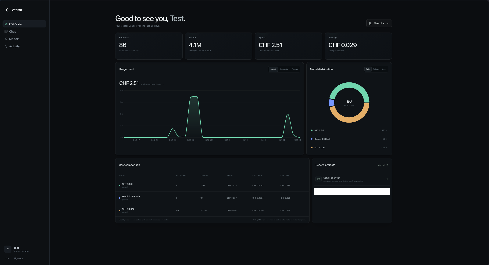

<div align="center">


# Vector

**A personal AI workbench for reliable, controlled execution.**

Self-hosted · Active development · Built with Next.js

[Vision](VISION.md) &nbsp;·&nbsp; [Architecture](docs/ARCHITECTURE.md) &nbsp;·&nbsp; [Roadmap](docs/ROADMAP.md) &nbsp;·&nbsp; [Security](docs/SECURITY.md)

</div>

---

## A workspace, not another chat wrapper

Vector brings conversations, project work, model providers and file workflows into one application. Its goal is simple: **finish useful work with predictable quality, sensible costs and clear human control.**

The experience is deliberately restrained: dark surfaces, clear typography, precise interactions and no ornamental dashboards.

## Inside Vector

**Conversations and projects.** Work in persistent chat threads, organize tasks in projects and inspect generated files without switching between tools.

**Models and execution.** Configure providers, inspect usage and run background work. Routing, agent execution and workflow modules already exist; their advanced behavior is being benchmarked and improved.

**Control and visibility.** Privacy checks, permissions, approvals and server inspection are part of the existing application. Critical automation is designed to remain subject to owner approval.

The interface is under active development. The current implementation is not presented as a complete autonomous system.

## The interface

Vector includes a cinematic black-hole login, workspace dashboard, conversations, model administration and a server view. The reference captures below show the login and workspace dashboard. They may predate current chat controls.

<!-- SCREENSHOT_GALLERY_START -->
<table>
  <tr>
    <td width="50%" valign="top">
      
      <p align="center"><strong>Cinematic login</strong></p>
    </td>
    <td width="50%" valign="top">
      
      <p align="center"><strong>Workspace dashboard</strong></p>
    </td>
  </tr>
</table>
<!-- SCREENSHOT_GALLERY_END -->

## How Vector works

Vector chooses its execution strategy based on the work, rather than running an agent team for every request.

**Fast path** — a direct model call for a question, summary or rewrite.

**Artifact path** — structured generation and deterministic renderers for documents and other files.

**Agent path** — tools, investigation and verification for work that genuinely needs multiple steps. Privileged actions require an approval boundary.

Provider quality, cost, latency, privacy and availability are intended to guide routing decisions. That advanced policy layer is still being developed and evaluated.

[Technical architecture and target stack →](docs/ARCHITECTURE.md)

## Technology

The current source contains a **Next.js 16 / React 19** application, with **PostgreSQL**, **Redis**, and application modules for providers, background jobs, artifacts and security policies.

```text
app/          UI, pages and API routes
components/   Interface and cinematic experience
lib/          Providers, routing, jobs, agents and artifacts
public/       Brand and third-party assets
docs/         Architecture, development and security
```

This repository contains reusable application and optional integration source, not a turnkey production deployment. Runtime secrets, databases, player/world records and host-specific configuration are intentionally excluded. The current tree is separated from private operating material; historical Git and PR content still need independent review before publication.

[Development guide](docs/DEVELOPMENT.md) · [Engineering checks](docs/ENGINEERING_CI.md)

## Current chat controls and privacy

The composer shows only the active mode. Its compact menu offers **Auto, Low, Normal, High, Search and Lokal**. Privacy is a separate request preference and never replaces ownership, project access, tool permissions or budget checks.

| Setting | Current behavior |
| --- | --- |
| Auto | Deterministic local statistics for supported, authorized and configured requests; existing provider/tool routing for other work. This is not yet a universal learned router. |
| Low, Normal, High | Existing provider modes with different task/output budgets. Live server facts require authorized tool evidence. |
| Search | Existing research/search path when available and authorized. |
| Lokal | Native local execution without cloud fallback. The current request stays exact; old complete turns are omitted to fit the text context. |
| Privacy on | Local review with cancel, placeholders or explicit original submission. Newly read tool evidence is separately protected. |
| Privacy off | Text remains unchanged while every other permission and local-only project boundary remains enforced. |

Original submission covers the exact reviewed message and included context. New tool findings cannot rewrite that approved text on later rounds. Local encrypted mappings restore answers and approved local tool arguments; web search and external fetches do not receive restored secrets through that mechanism. Inspection failures block external submission. Detection can miss private values and is not a guarantee of anonymization.

[Privacy behavior and verification](docs/PRIVACY_REVIEW.md) · [Local inference](docs/LOCAL_INFERENCE.md)

## Optional Minecraft and Discord integration

The [Minecraft bridge](docs/MINECRAFT.md) is a separate local service and Java addon. It supports addressed messages, fresh saved statistics, recipe/catalog adapters and bounded local conversation. It has independent policy, identity, replay protection and rate limits. Ordinary unaddressed chat is ignored.

Operators supply their own installed-mod inputs, data locations and verified player links. The public source contains no community player dataset or world. Reviewed knowledge cards are not a promise to understand every mod version, effective recipe or live server setting. A web release does not restart or migrate an installed game integration.

The web statistics adapter uses private runtime settings `VECTOR_MINECRAFT_DATA_PATH`, optional `VECTOR_MINECRAFT_STATS_PATH` and optional `VECTOR_MINECRAFT_SERVER_ALIASES`. Unconfigured Auto requests retain existing authorized server tools.

## Architecture and delivery status

The existing source provides direct calls, deterministic artifact builders, tool execution, jobs, access policy and usage tracking. The [architecture](docs/ARCHITECTURE.md) also describes target components and benchmark candidates; their names do not imply completed integrations.

The immediate priority is reliable chat/project execution, exact consent, complete server reads and measurable quality, cost and latency. New gateways, orchestration, skills and channels follow representative evaluations rather than replacing working infrastructure prematurely.

## Development and publication

Use locked dependencies through `npm ci` and isolated PostgreSQL fixtures for integration checks. CI uses Node.js22; the application container uses Node.js24. See the [development guide](docs/DEVELOPMENT.md), [engineering checks](docs/ENGINEERING_CI.md) and [contribution guide](CONTRIBUTING.md).

Every change extends the [changelog](CHANGELOG.md). Dated history and useful README sections must remain during cleanup. Generalize private references narrowly and preserve exact operational originals privately.

The repository remains private until a separate [publication review](docs/PUBLICATION.md) covers history, branches, PRs, artifacts, screenshots and licenses. A current-tree scan does not inspect those other stores. A merged PR is not evidence of a live release.

## What comes next

Immediate work focuses on reliable model selection, provider fallbacks and measurable quality. Artifact editing, selective agent orchestration, curated skills and additional communication channels follow in later phases.

[See the planned milestones →](docs/ROADMAP.md)

## Security and acknowledgements

Production changes and outgoing messages require explicit approval under Vector's intended operating policy. Deployment integrations outside this repository are **not yet fully audited**. [Read the deployment policy](docs/DEPLOYMENT.md).

The cinematic black-hole experience is adapted from [Gargantua by hasnain7abbas](https://github.com/hasnain7abbas/gargantua-blackhole). Vendored libraries retain their own licensing requirements. [Credits and third-party notices](docs/THIRD_PARTY.md).

---

<div align="center"><sub>Vector · MIT licensed · Copyright © 2026 KibouAkari · <a href="LICENSE">License</a></sub></div>
