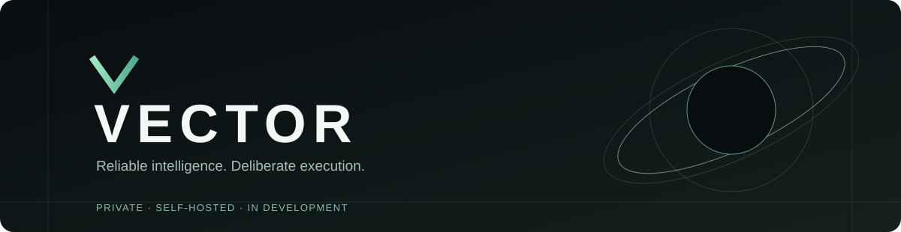
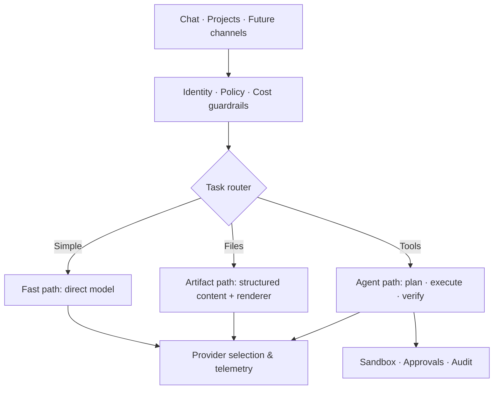

<div align="center">
  

  <p><strong>
    An independent, self-hosted AI workbench for reliable work,
    controlled autonomy and measurable quality.
  </strong></p>

  <p>
    <a href="VISION.md">Vision</a> ·
    <a href="docs/ARCHITECTURE.md">Architecture</a> ·
    <a href="docs/ROADMAP.md">Roadmap</a> ·
    <a href="docs/DEVELOPMENT.md">Development</a> ·
    <a href="docs/THIRD_PARTY.md">Credits</a>
  </p>

  <p>
    
    
    
    
  </p>
</div>

## The workspace

Vector combines conversational AI, projects, file workflows,
model connections, usage reporting, background jobs and
owner-controlled permissions in one interface.

Its long-term direction is a personal **AI operating system**,
not just another chat wrapper.

<table>
<tr>
<td width="50%">

<br/><strong>Chat & projects</strong>
<br/>Conversations, structured workspaces and generated files.
</td>
<td>

<br/><strong>Model infrastructure</strong>
<br/>Provider connections, usage and evolving task routing.
</td>
</tr>
<tr>
<td>

<br/><strong>Artifacts</strong>
<br/>Document generation and file handling,
with richer editing planned.
</td>
<td>

<br/><strong>Control & permissions</strong>
<br/>Privacy rules, owner approvals and audit-oriented execution.
</td>
</tr>
</table>

## Product screenshots

The current interface includes a cinematic login, usage dashboard,
conversation workspace, model administration and server overview.

Genuine, reviewed images will appear here after the
[privacy checklist](docs/screenshots/README.md) is completed.

**No mockups are presented as working product screenshots.**

## Architecture at a glance



The gateway, AG-UI event model, advanced agent runtime and
self-improvement workflows are **target architecture**,
not claims of deployed integrations.

Read the [architecture](docs/ARCHITECTURE.md) for details.

## Codebase

```text
app/          Next.js pages and API routes
components/   UI, cinematic transitions and reusable controls
lib/          Routing, providers, agents, artifacts and policies
public/       Brand assets and licensed third-party assets
docs/         Vision, architecture, roadmap, security and credits
```

## Development

This is a private development snapshot,
**not a ready-to-run public deployment**.

Production secrets, user data, databases and infrastructure
configurations are intentionally excluded.

```bash
# For a vetted development checkout only
npm ci
npm run build
```

A working deployment also requires environment-specific services
and configuration. Do not assume this starts a production environment.

## Principles

**Fast by default. Verified when needed. Secure by design.**

Vector favors a direct answer for simple tasks, deterministic
rendering for artifacts, and specialized agents only when
tools or deeper reasoning are justified.

See [Vision](VISION.md) ·
[Security](docs/SECURITY.md) ·
[Contributing](CONTRIBUTING.md) ·
[Acknowledgements](docs/THIRD_PARTY.md).

<sub>
Vector is under active development.
No general open-source license has been selected for Vector itself.
</sub>
