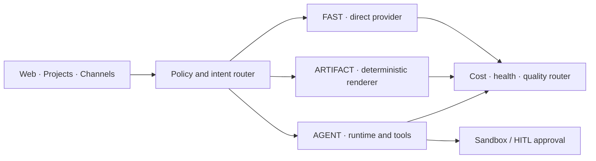

# Architecture

> This document separates **existing source modules**
> from the **target stack**.

The presence of a source module is not proof that
the complete feature is production-ready.

## Existing foundation

- **Next.js 16 / React 19** application and API routes.
- **PostgreSQL / Redis** and background-job modules.
- Model routing, provider configuration and usage modules.
- Agent execution, workflows and artifacts.
- Privacy, permission, approval and cost-control modules.
- Docker-backed deployment managed outside this Git snapshot.

## Target execution model

## Stack candidates

| Layer | Approach |
| :-- | :-- |
| UI | Vector Design System and selected assistant-ui primitives |
| Run state | Conversation-scoped AG-UI-style events |
| Agents | Mastra vs Pydantic AI benchmark; select one |
| Provider gateway | LiteLLM vs TensorZero benchmark; select one |
| Model selection | vLLM Semantic Router concepts and Vector telemetry |
| Skills | Agent Skills standard, curated Vector registry |
| Evaluations | Promptfoo, Langfuse, OpenTelemetry and custom fixtures |
| Security | Vector Permissions, Presidio, MCP Scan candidates |
| Tools | MCP registry; search → fetch → extract → browser |
| Documents | Existing renderers, Docling, future lossless OOXML edits |
| Execution | Sandboxes and approved host-agent actions |

Heavy services should run on demand to conserve Hetzner resources.

## Agent policy

- Simple rewrites use one model call.
- Documents use structured content and deterministic rendering.
- Research may run independent researchers and synthesize evidence.
- Coding uses exploration, implementation and testing.
- Reviewers run when justified, not on every trivial task.
- Critical changes require explicit owner approval.

## Skill lifecycle

Discover → Source/license check → Schema validation →
Security scan → Sandbox → Offline evaluation →
Compare against existing skill → Approval → Activation.

## Web capability ladder

1. Search with SearXNG.
2. Fetch and parse using HTTP/readability.
3. Extract with Firecrawl or Docling when needed.
4. Interact using Playwright MCP or Browser Use when justified.

## Reliability and privacy

Check capabilities, privacy, budget and provider health before
routing. Record predicted and actual cost, task success,
P50/P95 latency and fallback outcomes.

Never replay an irreversible action without appropriate
idempotency safeguards and authorization.

## Inference policy and accounting

The chat job carries a free-inference constraint through account-scoped selection to the provider adapter. Privacy review can mask selected findings or preserve an explicitly approved exact snapshot. Reported provider charges, configured-rate estimates and unknown usage are separate states. See [the contracts](FREE_USAGE_PRIVACY_ACCOUNTING.md).

## Implemented control modules, November 2026

The existing Next.js application now owns instruction skill versions, exact tool
approval grants, role capability policies, per-call budget reservations and a
queued active asset scanner. These use the existing PostgreSQL and worker
boundary; no new orchestration framework replaces it. Fast rules are the default
privacy detector and optional NER is explicit. See [control centre](CONTROL_CENTRE.md),
[scanner architecture](SECURITY_SCANNER.md) and [API contracts](CONTROL_CENTRE_API.md).
The earlier stack-candidate table describes options, not installed dependencies.

## Operations centre source

Brain retrieval is account-scoped and happens before request privacy review.
`lib/brain` stores encrypted bodies, revisioned corrections and keyed keyword
indexes. `lib/teams` extends the existing job executor with bounded specialists,
a worker, review and a PostgreSQL call-admission counter. All provider calls keep
the same monetary reservations and usage capture. It adds no recursive agent
framework or second worker contract.

`lib/connectors` separates fixed-origin reads from exact, approved single-use
actions. `lib/traffic` accepts signed collector observations and returns operator
views. The security web profile uses Host/SNI requests instead of shared-IP port
discovery. See [operations contracts](OPERATIONS_CENTRE.md) for scopes, failure
states, setup, limits and incomplete vendor workflows.
