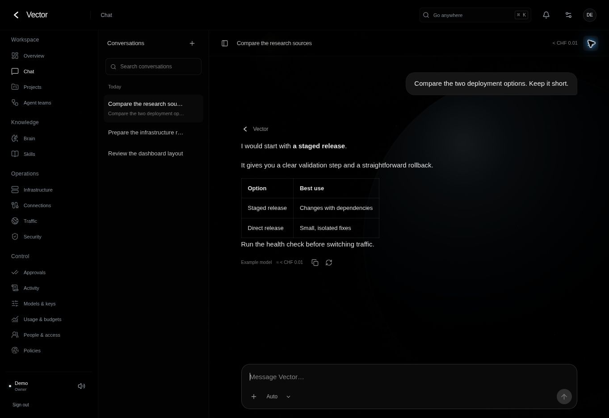

# Conversation interface references

The black canvas, Vector identity, existing API contracts and Traffic layout are
retained. The conversation surface uses its own scoped classes instead of the
old nested message/composer containers. Login and intro source are untouched.

| Reference                                                                                                                                             | Application in Vector                                                                                    | Boundary                                                                                            |
| ----------------------------------------------------------------------------------------------------------------------------------------------------- | -------------------------------------------------------------------------------------------------------- | --------------------------------------------------------------------------------------------------- |
| [Prompt Kit](https://github.com/ibelick/prompt-kit/tree/5a9496635cc0e1bf7679fe2a9e35d9b36b99c08a)                                                     | Composer autosizing and the bounded message/composer layout, adapted to controlled JavaScript components | MIT notice in `licenses/prompt-kit.MIT.txt`; simulated upstream messages/API calls are not included |
| [Radix Dialog](https://www.radix-ui.com/primitives/docs/components/dialog) and [Popover](https://www.radix-ui.com/primitives/docs/components/popover) | Actual runtime primitives for conversation options, mobile history, skill editor and GitHub import       | Pinned packages; focus, Escape, outside interaction and focus return stay with the primitives       |
| [assistant-ui Thread](https://www.assistant-ui.com/elements/thread)                                                                                   | Reference for separating conversation content, composer, history and message actions                     | Vector keeps its own job/runtime/privacy integration; assistant-ui's runtime is not installed       |
| [Geist Empty State](https://vercel.com/geist/empty-state)                                                                                             | Skills first-run and filtered states, with actions in the page header                                    | No fictitious example skills, generated usage or activation claims                                  |
| [Web Interface Guidelines](https://vercel.com/design/guidelines)                                                                                      | Semantic controls, visible focus, touch sizing, reduced motion and predictable input behavior            | GUI verification is recorded separately from source/unit checks                                     |

## Chat behavior

The default composer contains the attachment action, response-mode selection and
send/stop action. Privacy review, Brain, free-inference policy and selected skill
parameters live in conversation options. Those values remain in the existing
conversation state and request payload; closing the options does not reset them.
Disabling privacy review shows a compact warning in the conversation header.

Textarea height follows the controlled value, caps at 180px and scrolls internally
for longer drafts. Enter submits, Shift+Enter inserts a new line, and Enter during
IME composition does not submit. Upload handling, submission locks, background
job retries, cancellation and exact privacy consent use the existing pathways.
User messages have one bubble. Assistant text has a consistent reading width;
copy/retry actions appear on pointer hover, keyboard focus and touch devices.

History titles/previews display privacy tokens as readable labels, including
truncated tokens. This is a display transform only. It never restores secrets,
rewrites saved messages or changes provider payloads. The mobile history uses a
modal focus scope; desktop history remains a normal navigation column.

## Skills behavior

Create/edit and import are focused dialogs. Draft saving, immutable versions,
content fingerprints and exact-version activation remain server-controlled.
Import still requires source preview, pinned commit/content hash and the license
acknowledgment. Closing or moving an instruction into a dialog grants no tool or
execution permission. Workspace changes discard stale load responses and reset
editing/reviewer state until the new scope loads.

## Overview correction

Remove the redundant launch banner, show usage beside recent tasks on wide
screens, and keep the network globe compact. Recreate its material when the
asynchronously loaded geographic texture becomes available: adding a map to a
material compiled without one otherwise leaves a plain sphere. Country-ring
paths close individually. If WebGL is unavailable, the existing geographic map
replaces the canvas rather than a decorative blank sphere. Traffic's map/filter
layout and telemetry contracts are unchanged.

## Validation

The production build passes, together with 304 deterministic Node checks and
48 PostgreSQL/API checks in an isolated database. The runtime dependency audit
reports no known findings. The activity fixture uses explicit timestamps so its
visible recent task is inside the 12-row window while the older running task
still exercises the separate active list; production activity logic is unchanged.

The rendered production application was checked with synthetic data in the
managed browser. Desktop chat, draft persistence, mode selection, settings
Escape/focus return, skill draft saving and editor focus return were exercised.
A 390px iframe viewport checks the actual responsive styles and history drawer
focus/Escape behavior; it does not emulate a phone keyboard or touch hardware.
The browser disables WebGL, so the geographic fallback was visually verified;
the GPU globe is a source/build correction, not a GPU rendering certification.

No paid inference, external scan, production account or external message was
used. The test-only preview harness and synthetic session are outside the app
source. Login/intro files and authentication behavior are unchanged.

This is a screenshot of the compiled application with fixture messages and
usage, not production telemetry or a design mockup.
